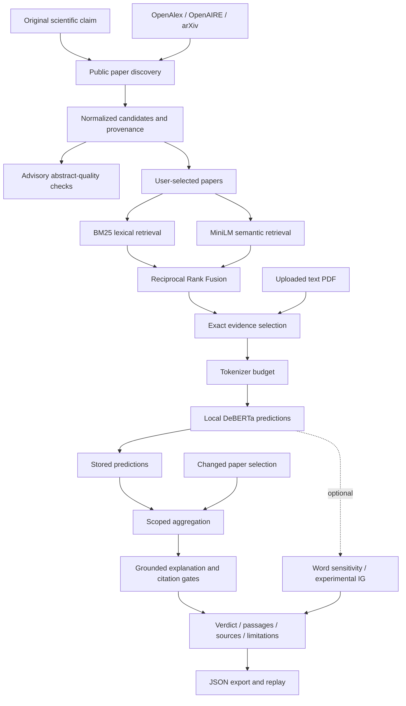

# Integrated architecture

The original claim, source identities, exact passage text and selected paper scope stay connected through every stage.

## Functional source packages

| Package under `src/research_verifier/` | Responsibility |
|---|---|
| `ui/` | Seven Streamlit workspaces and evidence display |
| `discovery/` | Search integration, provenance and abstract checks |
| `retrieval/` | BM25, embeddings, RRF and ranking validation |
| `evidence/` | Exact spans, semantic selection, PDFs and token budgets |
| `verification/` | NLI, adapter mapping and verdict aggregation |
| `explanations/` | Templates, citation gates, local generation and review |
| `interpretability/` | Recorded attribution, word perturbation and IG |
| `runtime/` | Setup/loading, paths, state, caching and background jobs |
| `contracts/` | Shared typed request/result models |
| `pipeline.py` | End-to-end orchestration |

`src/paper_search/` bundles the pinned discovery implementation while preserving its existing import name.

## Techniques and policies

Discovery uses local query generation and public catalogues, preserving the original claim. BM25 is custom NumPy code; MiniLM embeddings measure semantic similarity. RRF combines positions using `sum(1 / (60 + rank))`. The UI ranks selected available candidates; automatic top-five selection is an offline evaluation protocol.

The primary abstract route selects top-three semantic anchors at cosine threshold 0.5, supplies the exact whole original abstract when the claim pair fits 512 tokens, otherwise retains focused spans, then applies the 0.65 maximum eligible-span score gate. Oversized spans are rejected whole. The original baseline and PDF policies remain distinct.

DeBERTa receives evidence as premise and the original claim as hypothesis. SUPPORT/CONTRADICT predictions below 0.50 become NEUTRAL. Aggregation exposes SUPPORTED, CONTRADICTED, CONFLICTING or INSUFFICIENT over selected papers; failures have separate operational states.

Templates quote eligible evidence and preserve citation IDs. Gates check exact text, selection membership, context and verdict consistency, including both sides of conflict. Mechanical grounding does not establish independent scientific truth.

## Runtime boundaries

- Setup downloads pinned public model files explicitly; inference loads local files with remote code disabled.
- Fresh Live discovery sends the claim to public catalogues. There is no paid/hosted inference fallback.
- PDF upload is bounded to 20 MiB, 200 pages and two million extracted characters. OCR and arbitrary URL fetching are unsupported.
- Models are cached. Original native responses allow live-session subset aggregation without new neural inference; imported replay changes use a separately labelled policy.
- Request identities/deadlines discard stale results. Cancellation does not necessarily terminate an already running model thread.
- Persistence uses local files, session state and in-memory caches; no database or distributed cluster is required.
- Abstract-quality flags are advisory and do not modify text, ranking or predictions. Missing legacy provenance is disclosed.

The [Archify bundle](project_map/project-summary.html) preserves the pre-consolidation snapshot and historical Git links. This document describes current directory names; the migration manifest records path changes.
