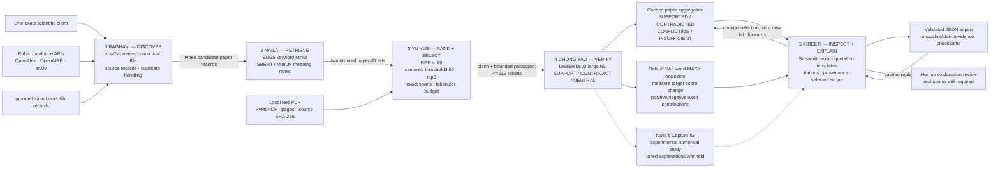

# From claim to evidence: the full project, explained simply

Imagine five detectives checking a sentence. They do not magically know the truth: they find research, choose clues, run a model and show exactly what was used. The result concerns the selected evidence, not every paper ever written.

## The five teammates

1. **Raghavi finds the books.** You type one scientific claim. Public OpenAlex, OpenAIRE and arXiv searches return paper metadata. spaCy helps extract concepts for queries. Canonical IDs, aliases and source records help handle duplicates and preserve provenance. A saved search can be imported instead. A PDF URL alone does not mean its full text was read.
2. **Naila sorts the books in two ways.** BM25 looks for matching words in titles/abstracts. SBERT/MiniLM turns text into vectors so meaning can be compared using cosine similarity. These produce two ordered paper lists, not scientific truth scores.
3. **Yu Yue combines the lists and picks clues.** RRF adds 1/(60+rank) across the lists. A separately pinned MiniLM selector scores sentences against the claim; the frozen policy keeps up to3 passages per paper at score>=0.50. It preserves exact source spans. The actual DeBERTa tokenizer checks the whole claim/passage pair against512 tokens and rejects oversized spans rather than silently shortening them. Local PDF upload joins here: PyMuPDF extracts text with pages and source hashes. Cross-encoder reranking is an evaluated alternative, not the default live path.
4. **Chong Yao checks each clue.** Local DeBERTa NLI reads passage=premise and claim=hypothesis. It predicts SUPPORT, CONTRADICT or NEUTRAL; a0.50 threshold can downgrade uncertain support/contradiction. Aggregation over selected papers yields SUPPORTED, CONTRADICTED, CONFLICTING or INSUFFICIENT. Processing failure is a different state, with no substituted scientific verdict. The frontend explicitly preserves both eligible sides of a conflict.
5. **Kireeti shows the detective's notebook.** Streamlit connects the components. The default explanation quotes exact evidence and validates its citations and claim. You can inspect sources, change selected papers, compare results, upload a text PDF and export/reload JSON. Original inference is cached, so subset aggregation does not rerun the neural model. Human-review forms collect actual ratings; ratings are never invented.

## Technical diagram

The PDF route does not pretend to perform public discovery or full-corpus ranking. It extracts the explicitly uploaded document and joins the shared evidence/verifier/explanation flow. A saved replay is explicitly labelled; it is not a fresh model run.

## What the technologies do

| Layer | Dependencies and techniques | Child-friendly description |
| --- | --- | --- |
| Interface | Python3.12, Streamlit, pandas; Streamlit charts use Altair/Vega-Lite and data transport uses PyArrow. | The control panel and scoreboards. |
| Contracts | Pydantic models; PipelineProvider protocol; typed discovery/ranking/verification objects. | Everyone uses the same labelled boxes so pieces fit. |
| Search | Pinned paper_search package; spaCy/en_core_web_sm; httpx/requests; free anonymous public catalogue calls. | The librarian and the roads to the libraries. A rate limit can still happen. |
| Retrieval | rank-bm25, Sentence-Transformers, NumPy, MiniLM embeddings, cosine similarity. | Find matching words and nearby meanings. |
| Fusion/selection | RRF, frozen semantic sentence selector, exact char/sentence provenance, budget rejection. | Combine contest positions and keep usable clues. |
| Verification | PyTorch, Hugging Face Transformers, local pretrained DeBERTa NLI, confidence thresholding and cached aggregation. | Check whether the clue agrees, disagrees or says too little. |
| Documents | PyMuPDF, local files, PDF page text and SHA-256 hashes. | Read the uploaded pages and keep their page numbers. Scanned/encrypted/empty files fail visibly. |
| Explainability | Word-level MASK occlusion, bounded batched forward calls, exact word offsets. Captum IG/adaptive quadrature remain research options. | Cover a word and see how the model's answer changes. IG is a different technique and has not passed the real-input studies. |
| Explanation | Grounded quotation templates; citation validation; optional local Qwen2.5-0.5B-Instruct under strict gates. | Show the exact quote rather than make up a new fact. Qwen remains experimental after schema failures. |
| State/reliability | Local model caches, background futures, deadlines, stale-result rejection, strict input scope, JSON export/replay. | Do expensive thinking once, remember it, and reject old or mismatched answers. |
| Validation | pytest, actual-model acceptance runners, Matplotlib research/reporting utilities, CSV/JSON metrics and blank human-review packets. | Test the plumbing separately from whether the science is correct. |

Hugging Face supplies public model files during explicit setup; it is not a hosted inference service in this app. Models run locally/offline. No database, paid hosted inference endpoint or API key is required for the core demo. New external searches still need internet. See DEPENDENCIES.json for the complete118-distribution environment inventory, including optional/dev/transitive packages.

### Pinned model identities

- Retrieval encoder: sentence-transformers/all-MiniLM-L6-v2, revision2a7cca6ad7605f3183bce07f677bda658059bbe9.
- Semantic selector: same MiniLM model family at revision1110a243fdf4706b3f48f1d95db1a4f5529b4d41; maximum256 encoder tokens; frozen selection policy.
- Verifier: MoritzLaurer/DeBERTa-v3-large-mnli-fever-anli-ling-wanli, revisionb3546ea6b0346eb6f8d5d68b13c7dc6d0376b3d7; CPU float32, max512 input tokens, threshold0.50.
- Optional generator: Qwen/Qwen2.5-0.5B-Instruct, revision7ae557604adf67be50417f59c2c2f167def9a775. Experimental, not the main explanation path.
- Reranking experiments use a local provisioned cross-encoder behind a scorer protocol; it is not loaded in the normal RRF-only workflow.

## Measured results and what they mean

| Result | Number | What it does NOT prove |
| --- | --- | --- |
| SciFact published RRF Recall@10 |95.9%;188 eligible dev claims,112 no-positive exclusions;5,183 papers. | Not final-verdict accuracy or all300-claim evidence accuracy. |
| CSFCube published RRF Recall@10 |39.2%;26 official fold1-test query/facet tasks; judged candidate pools;4,207 collection records. | Not unrestricted full-corpus search;24 dev tasks are separate, and splits are not fully paper-disjoint. |
| RECIPER published RRF Recall@10 |93.7%;1,024 generated questions against343 papers. | One known source target is not exhaustive expert relevance or sentence/verdict gold. |
| SciFact sentence evidence micro-F1 |0.179 with RRF top5 papers;0.444 with oracle gold papers;188 eligible dev claims. | Source-linked extraction is not solved; not official leaderboard parity. |
| Full-abstract verifier audit |131/181 correct,72.38%;28 truncated pairs excluded from209 annotated pairs. | Gold-cited SUPPORT/CONTRADICT abstracts only; not end-to-end or complete three-class accuracy. |
| Word-occlusion exploratory study | Sentence AP0.833 vs random0.438; rationale top1 hit75% vs17.5%. | Only4 short dev pairs from3 documents, gold target; not IG, significance or general XAI performance. Wrong predictions are retained. |
| Software validation |156 frontend tests;452 isolated owner-suite tests;8/8 fixed-candidate model acceptance cases. | Tests are not independent scientific examples; known annotated papers were deliberately included in acceptance pools. |
| Efficiency |100 subset changes:0 additional neural forwards; median1.14ms, p951.33ms. | Local preloaded-model observation under concurrent work, not a production SLA or an apples-to-apples inference speedup. |

Recall@10 asks whether a known relevant paper appears in the first10. MRR rewards finding the first relevant paper early. nDCG measures ranking quality; CSFCube also has separately graded nDCG. Evidence F1 checks selected sentence IDs against annotated rationales. These are different questions and are never pooled into one “accuracy”.

Published ranking/evidence artifacts are pinned at owner revision90aaca109585c12c877367b1a08fe4dfee4a4de3. The frontend validates and displays them; it did not independently rerun every full owner experiment. The current code snapshot is kireeti4ca3a22. Human scientific/source review, broader XAI validation and actual five-person video participation remain open human tasks.

## The whole story in one sentence

**Find research → sort papers → choose exact clues → ask a local model how they relate to the claim → show the quotes, uncertainty and scope so a person can inspect the answer.**

### Operating/setup dependencies and limits

The tested desktop environment is Windows with Python3.12. PowerShell/CMD provide the start/test wrappers; Git and pip provision pinned source/dependencies. Core Python APIs are usable without Streamlit. Hugging Face downloads happen during explicit setup, followed by local inference. Local filesystem/JSON storage replaces any need for a database service. Uploaded text PDFs are bounded to20MiB,200 pages and2 million extracted characters; replay imports have their own10MB limit. Models, caches and raw datasets are ignored local assets. New public searches and initial setup require internet; cached replay/benchmarks and installed-model inference do not.

Authoritative dependency inputs are requirements.txt, requirements-lock.txt, requirements-discovery-lock.txt, requirements-local-llm.txt, requirements-attribution.txt and requirements-local-pdf.txt in explanation_frontend. DEPENDENCIES.json records the observed complete environment; use the requirement/setup files to provision the app rather than treating all118 installed distributions as direct dependencies.
