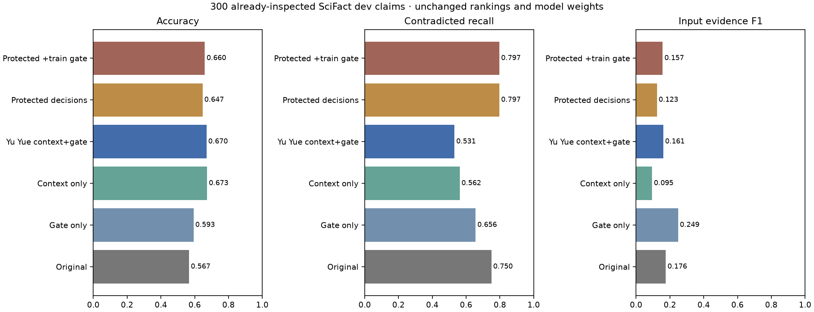

# Context and contradiction-protection study — 11 November 2026

This is an exploratory comparison on the same previously inspected SciFact development set. Candidate rules and the optional gate were selected on 200 training claims; no development metric selects a deployment default. The production frontend and original frozen results are unchanged.

## Main finding

The train-selected protected-decision +0.65 context-gate candidate reaches **66.0% accuracy and 79.7% contradiction recall**, versus 56.7%/75.0% originally and 67.0%/53.1% for Yu Yue’s candidate. It retains 198/300 correct, fixes 36 original errors and introduces 8 regressions; 8 regressions are no-positive/INSUFFICIENT cases.

This is a tradeoff, not a universal upgrade. Relative to Yu Yue’s candidate, accuracy changes by -1.0 percentage points and contradiction recall by +26.6 points. Contradiction precision is 53.7% versus 72.3%; INSUFFICIENT recall is 59.8% versus 82.1%; evidence F1 is 0.157 versus 0.161. The guard preserves baseline errors as well as successes.

Gate-only input evidence F1 is 0.249, with 59.3% accuracy and 65.6% contradiction recall. These arms expose different tradeoffs. Keep the default unchanged pending review and independent evaluation.

## What was tested

- Original focused sentences, gate-only 0.65, whole-abstract context only, Yu Yue context+gate0.65, a training-selected guard, and that guard with a separately train-selected context gate.
- Guard: keep the original focused Supported/Contradicted verdict. If it is Insufficient/Conflicting, use bounded abstract context. Context stays exact-source, fits the actual 512-token premise/claim limit or falls back to the original focused passages.
- Training selected `protect_decisive`. The second training experiment selected context gate **0.65**; the gate never removes a protected decisive verdict.
- Local CPU run made 950 new passage predictions and reused 193 measured/cached predictions. Baseline verdicts reproduced 300/300. Context+gate agrees with Yu Yue’s saved candidate on 300/300 claims.
- Existing focused CPU predictions were reused with their measured label/confidence; missing raw class probabilities were not invented. The guard-training comparison uses the pinned owner’s actual training predictions. The gate-training context predictions were evaluated locally.

## Results

| Condition | Accuracy | Macro F1 | Supported recall | Contradicted recall | Contradicted precision | Insufficient recall | Evidence precision | Evidence recall | Evidence F1 |
|---|---:|---:|---:|---:|---:|---:|---:|---:|---:|
| baseline | 56.7% | 0.584 | 37.9% | 75.0% | 52.7% | 67.0% | 0.107 | 0.484 | 0.176 |
| gate_only_0.65 | 59.3% | 0.595 | 33.1% | 65.6% | 62.7% | 84.8% | 0.178 | 0.413 | 0.249 |
| context_only | 67.3% | 0.678 | 71.8% | 56.2% | 65.5% | 68.8% | 0.051 | 0.762 | 0.095 |
| context_and_gate_0.65 | 67.0% | 0.666 | 60.5% | 53.1% | 72.3% | 82.1% | 0.093 | 0.612 | 0.161 |
| train_selected_guard | 64.7% | 0.650 | 66.9% | 79.7% | 52.0% | 53.6% | 0.069 | 0.596 | 0.123 |
| train_selected_guard_and_gate | 66.0% | 0.661 | 64.5% | 79.7% | 53.7% | 59.8% | 0.092 | 0.560 | 0.157 |

Evidence scores cover complete original annotated sentences. Extra unannotated context counts as false positives under the closed benchmark; partial sentences count as extra false positives. Guarded context routes include both focused and context input. These are not official SciFact leaderboard metrics.

## Fixes and regressions

| Candidate | Baseline errors fixed | New errors introduced | Net additional correct |
|---|---:|---:|---:|
| context_and_gate_0.65 | 65 | 34 | +31 |
| train_selected_guard | 39 | 15 | +24 |
| train_selected_guard_and_gate | 36 | 8 | +28 |

Yu Yue’s candidate loses 17 of the baseline’s correctly contradicted claims. `results/contradiction_regressions.csv` separates context-only losses, gate-only losses and combined interactions; tags can overlap and are diagnostic, not causal proof.

The guard preserves any already-correct focused contradiction by its decision rule. It also preserves wrong focused decisive predictions, so false contradictions and false supports remain. This is an explicit tradeoff, not a universal fix.

## What to review

Software checks: the complete frontend suite passes, including context/guard/cache-translation and Windows log-encoding regressions. See software_tests in results/summary.json for the captured result.

- `results/changed_claims.csv`: every changed verdict for both new candidates, including regressions.
- `results/contradiction_regressions.csv`: original correct contradictions lost by the prior candidate, and the new candidates’ outcomes.
- `results/per_claim_results.csv`: all 1,800 measured claim/condition rows; no failed cases excluded.
- `outputs/context_study_20261111/local_traces/`: exact focused and context model input/predictions. Saved research replays display the decisive arm; auxiliary inputs remain in traces and evidence accounting.
- `TRAIN_FROZEN.json`, `GATE_TRAIN_FROZEN.json` and the run protocol: training choices and provenance.

## Limits and next action

Train/dev IDs are disjoint, but 1 exact claim text is shared. The primary 300 cohort stays intact. An additional text-disjoint sensitivity analysis (299 claims) is retained in results/summary.json; it is not substituted for the primary result. Related papers/claim variants can still overlap.

Do not replace the default solely because one development metric rises. Review class costs and both new candidates’ regressions, then run an independent evaluation with the chosen policy frozen. Related train/dev claims or papers may overlap; claim-bootstrap intervals do not remove this dependence. CSFCube/RECIPER retrieval results are unchanged and do not supply equivalent verdict labels.

No model weights, NLI threshold, ranking, public API dependency or source claim were changed. All additions stay inside explanation_frontend. Full models/corpora/raw caches remain ignored by Git.
