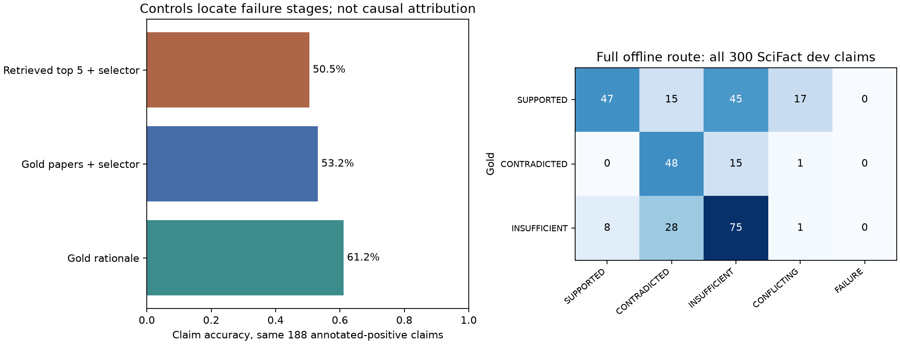
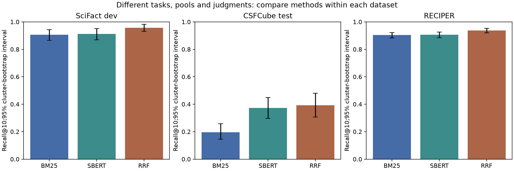

# Full-pipeline validation — 10 November 2026

Baseline `0e724e74ee38b1459af2870a2cdb9aa4c438bf26`; pinned models, data hashes and frozen settings in `PROTOCOL.json` and `BASELINE.json`. No threshold or model was tuned on these results.

## What was executed

- All 300 SciFact dev claims against all 5,183 corpus papers. BM25/SBERT top 100 branches, RRF(k=60), automatic top 5 papers, actual frozen semantic selector, 512-token budget, DeBERTa NLI, aggregation, grounded templates and replay checks. No gold-paper injection.
- Privileged gold-rationale and gold-paper controls on 188 annotated-positive claims. 112 no-positive claims stay in the full-route denominator as closed-benchmark INSUFFICIENT.
- CSFCube 24 dev /26 test query-facet tasks and RECIPER 1,024 questions, independently rerun for BM25, SBERT and RRF. CSFCube and RECIPER have retrieval judgments, not NLI or sentence-evidence gold labels.
- Separate clean Windows Python environment, exact dependency installation, pip check, full test suite, offline actual-model smoke, fresh public-provider smoke, PDF rejection/real-PDF tests, synthetic language tests and actual repeated retrieval/NLI/XAI calls.

## Scientific results

| Condition | Claims | Accuracy | Macro F1 | Evidence micro F1 on positive claims | Processing failures |
|---|---:|---:|---:|---:|---:|
| oracle_gold_rationale | 188 | 61.2% | 0.761 | 1.000 | 0 |
| gold_papers_production_selector | 188 | 53.2% | 0.682 | 0.436 | 0 |
| retrieved_papers_production_selector | 300 | 56.7% | 0.584 | 0.176 | 0 |

Full-route accuracy 95% bootstrap interval: **56.7% [51.0%, 62.0%]**. Comparing controls: use the same 188 positive claims; full-route positive-only accuracy is 50.5%.

Macro F1 uses two gold-present classes in controls and three in the full cohort; these columns are not directly comparable. Oracle evidence F1=1 is by construction, not learned selector performance.

| Dataset / split | Method | Queries | Recall@10 | MRR@10 | nDCG@10 |
|---|---|---:|---:|---:|---:|
| SciFact dev | bm25 | 188 | 0.906 | 0.779 | 0.805 |
| SciFact dev | sbert | 188 | 0.912 | 0.731 | 0.774 |
| SciFact dev | rrf | 188 | 0.956 | 0.806 | 0.833 |
| CSFCube / fold1_dev | bm25 | 24 | 0.223 | 0.451 | 0.280 |
| CSFCube / fold1_dev | sbert | 24 | 0.390 | 0.600 | 0.432 |
| CSFCube / fold1_dev | rrf | 24 | 0.335 | 0.522 | 0.386 |
| CSFCube / fold1_test | bm25 | 26 | 0.196 | 0.551 | 0.261 |
| CSFCube / fold1_test | sbert | 26 | 0.373 | 0.622 | 0.427 |
| CSFCube / fold1_test | rrf | 26 | 0.392 | 0.648 | 0.438 |
| RECIPER / entire released QA set; frozen zero-shot settings, no training or tuning | bm25 | 1024 | 0.903 | 0.789 | 0.817 |
| RECIPER / entire released QA set; frozen zero-shot settings, no training or tuning | sbert | 1024 | 0.905 | 0.744 | 0.783 |
| RECIPER / entire released QA set; frozen zero-shot settings, no training or tuning | rrf | 1024 | 0.937 | 0.818 | 0.847 |

CSFCube graded nDCG uses exponential gains 2^grade−1 and appears separately in the JSON. Binary relevance is grade ≥2. RECIPER is adapted source-paper retrieval over original titles/abstracts; generated answers are excluded. Its single source-paper target is not exhaustive relevance.

## Reliability and limitations

- Clean dependency install exit 0; pip check exit 0; final clean suite exit 0; offline actual-model smoke exit 0. Initial run had 162 passes and one 3-second UI test timeout under concurrent benchmark load; AppTest allowance raised to 15s, then 163/163 passed. After adding the checkout-newline regression check, the final clean suite passed 164/164. No application decision logic changed.
- Live functional smoke: ok; 9 candidates / 3 verified papers. Public-service availability and rate limits remain external dependencies. A working live response is not an accuracy measurement.
- PDF checks: 7/7. Includes two-column text, image-only rejection, encryption, malformed input, 201-page rejection, 20MiB limit and an original scientific PDF with exact page/span export/replay. Real PDF result: INSUFFICIENT; functionality does not imply scientific correctness or perfect reading order.
- Synthetic language expectations: 12/15. Failures are retained: changes in population/generalisation can incorrectly turn unknown evidence into a confident contradiction.
- NLI repeatability: 5/5 exact probability repeats. Retrieval: 30/30 repeated top 20 lists. These are bounded checks on this machine/software stack.
- Two new synthetic word-MASK occlusion cases have repeatability and exact-offset checks, including a wrong verifier prediction. They are diagnostic demonstrations, not additional SciFact plausibility evidence. Prior four-pair occlusion pilot remains exploratory; IG remains experimental after failed convergence gates.
- Raw oracle rationale-pair ECE(10 bins): 0.398, n=338. Gold labels cover SUPPORT/CONTRADICT only. Do not present this as three-class or aggregate confidence calibration. High model confidence does not guarantee a correct verdict.
- SciFact dev and previously published CSFCube results were already inspected. These are frozen descriptive audits, not unseen holdout performance. CSFCube test has only 26 tasks; dev/test share query-paper identities. RECIPER uses the entire released QA set with frozen zero-shot settings. Intervals are descriptive and do not eliminate dataset dependence.
- Production selector splits abstract strings; sentence evidence credit requires full coverage of the original annotated sentence, with fragments counted as extra false positives. This intentionally conservative measure is not official SciFact leaderboard parity. Closed-world judgments can mark unannotated but plausible passages as false positives.
- SciFact uses production retrieval encoder revision2a7… with Porter BM25. CSFCube/RECIPER use published protocol encoder1110… with simple BM25; results are not one identical configuration across domains. The pinned lexical retriever is custom NumPy BM25, not rank-bm25.
- Desktop validation found CRLF-only source differences between checkouts. Source checks now retain raw hashes and accept matching LF-normalized hashes; actual source edits still fail the frozen-state gate. Measured artifacts/replays preserve their exact bytes in Git.
- Offline full-corpus automatic top 5 selection is an evaluation wrapper. The public-web and interactive user-selection journey is tested separately; this is not a benchmark of public-web discovery recall.

## Error catalogue and next work by owner

Pinned owner suites rerun today: 452 passed across 4 owners. Isolated copies, external network blocked; verifier initialization uses the actual pinned local model. Artifact accounting/independent sklearn checks: 103/103.

`results/error_catalogue.csv` retains 133 failed full-route/synthetic cases. Tags can overlap and identify where to investigate, not proven causes.

| Owner | Working and tested | Open work |
|---|---|---|
| Raghavi | Fresh public discovery handoff to real selector/verifier; source provenance and provider-error tests | [PENDING] Test provider recall on a shared query set; rate limits and changing indexes cannot be guaranteed by local tests. |
| Naila | BM25/SBERT three-domain runs; deterministic retrieval subset; word occlusion repeatability | [PENDING] Review retrieval misses and population-error explanations. IG convergence remains unresolved; larger unbiased XAI validation is pending. |
| Yu Yue | RRF, actual semantic selection, whole-span token budgets, three-domain protocols | [PENDING] Inspect complete-rationale misses/partial sentence fragments. Any splitter/selector change needs a new version and separate development evaluation. |
| Chong Yao | Real local NLI, cached aggregation, source-linked outputs and repeatability | [PENDING] Review oracle errors, NEUTRAL/CONTRADICT confusion, population shift and confidence reliability. Any threshold/calibration work needs separate development data. |
| Kireeti | Integrated templates, claim/subset state, PDF safeguards, replay, clean setup and review exports | [PENDING] Review real PDF reading order and representative good/bad replays with teammates; human usefulness/citation judgments remain pending. |

## What you need to review

1. Open `results/pipeline_accuracy.png` and `results/retrieval_domains.png`; check that these are the results you are willing to present, including weak metrics.
2. Open `results/error_catalogue.csv` and compare good and bad SciFact replays in `outputs/validation/scifact_full/replays` using Replay/import. Keep the same claim when inspecting evidence and subset verdicts.
3. Inspect `outputs/validation/pdf/real-arxiv-replay.json` for source-page correctness and reading order; the returned verdict can still be scientifically wrong.
4. Run a personal claim and a personal text PDF. Record human feedback separately; no human scores have been filled in.
5. Use `outputs/validation/review-kit.zip` to share measured reports/replays. Models, private data and downloaded corpora are excluded.

## Reproduce

From explanation_frontend, run `validate.cmd`. Existing completed frozen study artifacts are reused, not silently rerun. For another SciFact run, use `python -m explanation_frontend.evaluation.validation.scifact --output scifact_repeat` from the repository root; preserve the original outputs. Add `-CleanSetup` to validate.cmd for another isolated Python environment check. If dependencies/models are absent, run the existing `setup.ps1` followed by `setup-pipeline.ps1` (which includes discovery and attribution setup). PowerShell can launch these with `-ExecutionPolicy Bypass` for that process. All writes stay under this folder.

Full per-condition results: `results/test_results.csv`; machine-readable metrics: `results/validation-summary.json`; source/data/model hashes: `outputs/validation/BASELINE.json`. The report distinguishes measured results, fixture acceptance and pending human validation.
